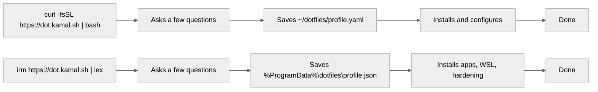

# dotfiles

One YAML file describes a machine. `./install.sh` makes the machine match it, and it
is safe to rerun at any time: it changes only what differs from the config.

## How it works



## Linux / WSL (Debian 12+, Ubuntu 24.04+, Mint, …)

```bash
curl -fsSL https://dot.kamal.sh | bash
```

It clones this repo to `~/dotfiles`, asks a few questions about the machine, and sets
it up. Run it as your normal user, not with `sudo`. Later runs: `~/dotfiles/install.sh`
(`plan` to preview first).

## Windows

From an elevated Windows PowerShell:

```powershell
irm https://dot.kamal.sh | iex
```

It installs the apps, sets up WSL with Ubuntu 24.04, and debloats and hardens Windows
(asks first). Then open Ubuntu and run the Linux steps above.

## More

| Doc | What's in it |
| --- | --- |
| [USAGE.md](USAGE.md) | Every command and flag, Linux Mint desktop and hardening, Windows options |
| [FEATURES.md](FEATURES.md) | What each task does, the machine profile questions, commit checks |
| [MANAGING.md](MANAGING.md) | Where each kind of change goes, adding apps and tasks, development |
| [CLOUD.md](CLOUD.md) | Claude Code cloud environments |
| [web/README.md](web/README.md) | How `dot.kamal.sh` serves the installers |
